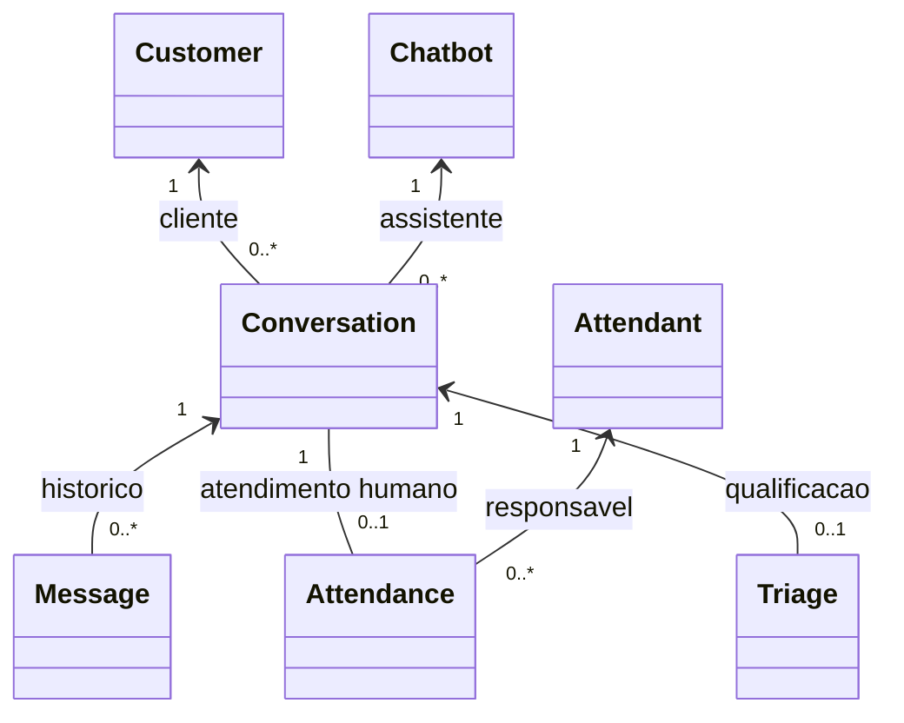

# Arquitetura

## Modelo orientado a objetos

As entidades centrais são `Customer` (cliente), `Attendant` (atendente),
`Conversation` (conversa), `Message` (mensagem), `Chatbot` e `Attendance`
(atendimento). `Triage` complementa os dados de qualificação.

* Um cliente possui várias conversas, cada uma vinculada a um chatbot.
* Uma conversa possui várias mensagens e, opcionalmente, uma triagem.
* Uma conversa pode ter um atendimento humano vinculado a um atendente.
  Um atendente pode participar de vários atendimentos.



`Conversation.assume`, `close`, `closeForInactivity` e
`changeAutomatedStatus` validam as mudanças de estado. Assumir cria o
`Attendance`; encerrar atualiza a conversa e seu atendimento juntos.
Os serviços orquestram essas operações dentro de transações.
`Chatbot.reply` implementa as respostas locais utilizadas quando a IA não
produz resposta. As interfaces `WhatsAppClient`, `AiClient` e
`IntentClassifier` fornecem abstração e polimorfismo. Não há necessidade
de criar herança artificial entre entidades sem relação de especialização.

Os campos `assignedTo` e `assignedAt` continuam como projeções compatíveis
com a API e o dashboard. O domínio os atualiza ao assumir o atendimento.
O contrato atual identifica atendentes pelo nome; autenticação e identificação
por uma conta de operador continuam fora deste modelo.

## Visão geral

O backend é uma API REST em camadas (*layered architecture*), o padrão mais
simples e mais fácil de explicar/manter em um projeto acadêmico com uma
equipe pequena. Não há necessidade de algo mais elaborado (hexagonal,
CQRS, microsserviços) para o escopo atual: um único serviço que recebe
mensagens, aplica regras simples e persiste em um banco relacional.

O backend é o núcleo da aplicação e atende **dois canais de entrada** que
compartilham exatamente a mesma lógica de chatbot:

```
Simulador / Frontend ──▶ POST /api/v1/webhook/whatsapp      ──┐
  (static/simulator)                                          │
                                                              ├──▶ MessageProcessingService
WhatsApp (Meta Cloud API) ──▶ POST /api/v1/webhook/whatsapp/meta ─┘        (o chatbot)
                                                                           │
      ┌────────────────────────────────────────────────────────────────────┘
      ▼
Webhook / Controller  (camada web: valida entrada, define rotas e códigos HTTP)
      │
      ▼
Service                (regras de negócio e orquestração)
      │
      ├──▶ Repository  (acesso a dados via Spring Data JPA)
      │        │
      │        ▼
      │     PostgreSQL
      │
      └──▶ Integration (WhatsAppClient - envio da resposta ao cliente)
```

## Pacotes

```
com.chatbot.whatsapp
├── ChatbotApplication.java     # ponto de entrada (main)
├── controller/                 # camada web: recebe HTTP, valida, delega ao service, define status code
├── service/                    # regras de negócio e orquestração
│   ├── chatbot/                # classificação de intenção e geração de resposta do bot
│   └── triage/                 # coleta guiada e estruturação da triagem
├── repository/                 # interfaces Spring Data JPA (acesso a dados)
├── entity/                     # entidades JPA (mapeiam as tabelas do banco)
│   └── enums/                  # enums de domínio (status, direção, canal)
├── dto/
│   ├── request/                # payloads recebidos pela API
│   └── response/                # payloads devolvidos pela API
├── integration/
│   ├── whatsapp/                # tudo que conhece o formato da Meta: envio, parsing do webhook e assinatura
│   └── ai/                      # provedor do assistente virtual: cliente HTTP, prompt e base de conhecimento
├── config/                      # beans de configuração (ex.: OpenAPI/Swagger)
├── exception/                   # exceções de negócio + tratamento centralizado (RestControllerAdvice)
└── util/                        # telefone (normalização, link wa.me, máscara) e descrição de erros sem dados pessoais
```

Cada camada só conhece a camada imediatamente abaixo dela:

* `controller` conhece `service` e `dto`, nunca `repository` ou `entity` diretamente.
* `service` conhece `repository`, `entity` e `integration`.
* `repository` conhece apenas `entity`.

Essa separação existe para que, por exemplo, trocar o banco de dados ou o
provedor de WhatsApp não exija alterar os controllers, e para que regras de
negócio não fiquem espalhadas (o pedido do projeto de "não colocar toda a
regra dentro do Controller" é resolvido colocando a orquestração em
`MessageProcessingService`, e a lógica de "o que o bot entende/responde" em
`service.chatbot`).

## Fluxo de uma mensagem (`POST /api/v1/webhook/whatsapp`)

1. `WebhookController` recebe o payload, valida com Bean Validation
   (`@Valid`) e delega para `MessageProcessingService`.
2. `MessageProcessingService` (a orquestração):
   1. busca ou cria o `Customer` pelo telefone (`CustomerService`);
   2. busca a conversa ativa do cliente ou cria uma nova (`ConversationService`);
   3. grava a mensagem recebida (`MessageService.recordInbound`);
   4. verifica primeiro se a mensagem indica uma reclamação; nesse caso,
      interrompe a automação e envia a conversa para a fila humana; pedidos
      explícitos de atendente (`HumanRequestDetector`) seguem o mesmo caminho
      (`HumanHandoffService`);
   5. inicia ou continua a coleta de nome, empresa e assunto
      (`InformationCollectionService`); na primeira mensagem, com o
      assistente virtual ligado, ele pode encaminhar a conversa direto para a
      fila humana;
   6. quando a coleta já terminou, classifica a intenção do texto e usa a
      resposta do chatbot atual; com o assistente virtual, a decisão é
      responder, pedir detalhes ou encaminhar, e respostas seguidas sem
      solução também encaminham (ver "Respostas com IA e fallback");
   7. ao completar os campos, gera um resumo e marca a conversa como `QUALIFIED`;
   8. marca a mensagem recebida como processada e grava a mensagem de resposta;
   9. atualiza o "contexto" e o horário da última interação da conversa;
   10. envia a resposta ao cliente via `WhatsAppClient` - o `MockWhatsAppSender`,
      que apenas loga, ou o `MetaWhatsAppClient`, que entrega de verdade pela
      Cloud API, conforme `whatsapp.enabled` (ver "Canal WhatsApp" adiante).
3. O controller devolve `201 Created` com um resumo do que foi processado.

Enquanto a conversa estiver em `WAITING_HUMAN` ou `HUMAN_ACTIVE`, o webhook
continua persistindo mensagens recebidas, mas não gera resposta automática.
A equipe opera a fila pelos endpoints de assumir, responder e encerrar em
`ConversationController` e `HumanAttendanceService`.

**Concorrência entre bot e atendente.** O processamento de uma mensagem
começa bloqueando a linha do cliente (`SELECT ... FOR UPDATE`, em
`CustomerService.findOrCreateByPhone`) e só a libera no fim da transação,
depois de enviar a resposta. Assumir, responder e encerrar bloqueiam o mesmo
cliente antes de ler a conversa (`HumanAttendanceService`). Com isso, duas
mensagens do mesmo cliente nunca são processadas ao mesmo tempo, e uma
resposta automática nunca é enviada depois de a conversa ter sido encaminhada
ou assumida. O teste `BotAndAttendantConcurrencyTest` reproduz essa corrida
com duas threads.

`DashboardController` expõe a visão de leitura usada pelo front-end.
`DashboardService` consolida contagens e transforma `Triage` em
DTOs com os dados essenciais do cliente e da conversa, sem expor entidades
JPA diretamente.

A interface em `static/dashboard` é servida pelo mesmo Spring Boot em
`/dashboard`. Ela consome somente a API REST existente, mantendo a camada
visual separada das regras de negócio e sem exigir um segundo processo de
frontend no desenvolvimento ou no deploy.

## Canal WhatsApp (Meta Cloud API)

O WhatsApp é um **segundo canal de entrada** para o mesmo chatbot, não uma
funcionalidade paralela. A regra que orientou o desenho foi: nenhuma linha
de lógica de chatbot duplicada.

```
Usuário no WhatsApp
      │
      ▼
Meta Cloud API
      │  POST (envelope da Meta + X-Hub-Signature-256)
      ▼
MetaWebhookController          valida assinatura, responde 200 rápido
      │
      ▼
MetaWebhookPayloadParser       envelope da Meta -> List<WhatsAppInboundMessage>
      │
      ▼
WhatsAppInboundService         deduplica, descarta o que não é texto
      │
      ▼
MessageProcessingService  ◀──── o MESMO serviço que o simulador usa
      │                         (triagem, reclamação, intenção, IA, persistência)
      ▼
WhatsAppClient -> MetaWhatsAppClient
      │  POST /{version}/{phone-number-id}/messages
      ▼
Meta Cloud API ──▶ Usuário no WhatsApp
```

Pontos de desenho relevantes:

* **Rotas separadas.** O endpoint da Meta é
  `/api/v1/webhook/whatsapp/meta`, distinto do
  `/api/v1/webhook/whatsapp` usado pelo simulador. O envelope da Meta é
  incompatível com o payload simplificado, e a Meta exige `200` (o outro
  devolve `201` com o `botReply` no corpo, contrato do qual o simulador
  depende). Unificar as rotas quebraria o simulador e colocaria a Meta em
  loop de reentrega.
* **O envio da resposta não é feito pelo controller do webhook.** Quem
  envia é o próprio `MessageProcessingService`, no fim do processamento,
  via `WhatsAppClient` - comportamento que já existia. Foi o que permitiu
  reaproveitar o fluxo inteiro sem alterá-lo: bastou passar a existir uma
  implementação real de `WhatsAppClient`.
* **Uma única implementação de `WhatsAppClient` ativa por vez**, escolhida
  por `whatsapp.enabled` via `@ConditionalOnProperty`:
  `MockWhatsAppSender` (false, padrão) ou `MetaWhatsAppClient` (true).
* **Idempotência.** A Meta reentrega qualquer notificação que não receba
  `200`. O id da mensagem (`wamid...`) é gravado em `messages.external_id`,
  que tem índice único (V4), e uma reentrega é descartada antes de chegar
  ao chatbot. Sem isso, o bot responderia duas vezes e a coleta da triagem
  avançaria de etapa com o mesmo dado.
* **Autenticidade.** A URL do webhook é pública. A defesa real é a
  assinatura `X-Hub-Signature-256` (HMAC-SHA256 do corpo cru com o App
  Secret), verificada em `WhatsAppSignatureVerifier`. O
  `webhook-verify-token` só participa do handshake `GET` inicial e não
  protege as notificações.
* **Tolerância a falhas.** O parser nunca lança exceção por campo
  inesperado, o processamento é isolado por mensagem, e uma falha no envio
  ao provedor é registrada em log sem propagar - a mensagem do cliente já
  foi processada e persistida, e derrubar o fluxo faria a Meta reentregar.

* **Status de entrega.** As notificações `statuses` do mesmo webhook são
  lidas por `MetaWebhookPayloadParser.parseStatuses` e aplicadas por
  `WhatsAppStatusService` à mensagem enviada com o mesmo `wamid`
  (`SENT` → `DELIVERED` → `READ`, ou `FAILED`). O status só avança.
* **Novas tentativas.** `MetaWhatsAppClient` repete o envio no máximo 3
  vezes em falhas temporárias (`429`, `5xx`, códigos de limite da Meta e
  falha de conexão antes do envio). Tempo esgotado depois do envio não é
  repetido, para não duplicar a mensagem ao cliente.
* **Janela de 24 horas.** `CustomerServiceWindow` impede que a resposta de um
  atendente seja enviada mais de 24 horas depois da última mensagem do
  cliente (a Meta exigiria template aprovado).

Como consequência de `HumanAttendanceService.reply()` também usar
`WhatsAppClient`, a resposta que um atendente escreve no dashboard chega ao
WhatsApp do cliente sem nenhum código adicional.

### Atendimento pelo próprio WhatsApp (botão "Ir para a conversa")

O dashboard também permite continuar o atendimento fora dele. O botão
**Ir para a conversa** (conversas `WAITING_HUMAN` e `HUMAN_ACTIVE`) abre
`https://wa.me/<telefone do cliente>` em uma nova aba. Em `WAITING_HUMAN`, o
dashboard primeiro assume a conversa pelo endpoint existente de
`claim`, o que pausa o bot somente nela. O link é montado no backend
(`DashboardTriageResponse.customerWhatsAppUrl`) a partir de
`PhoneNumbers.whatsAppLink`, a função central de normalização de telefones,
também usada pelo botão de contato e pela validação de
`WHATSAPP_CONTACT_PHONE`. Se o telefone for inválido, o campo vem nulo e o
dashboard mostra um aviso em vez de abrir um link quebrado.

O link abre a conversa na conta de WhatsApp do atendente. As mensagens que ele
enviar pelo aplicativo não passam pelo backend; as do cliente continuam
chegando pelo webhook e sendo registradas no histórico da conversa.

### Limitações conhecidas

* O processamento é **sincrônico**: o `200` só volta depois de persistir e
  enviar a resposta. Com a IA habilitada isso inclui o timeout do provedor
  (padrão 10s). Suficiente para o volume atual; um volume alto pediria
  processar em background e responder `200` imediatamente. Esse modelo foi
  mantido porque o projeto não tem um mecanismo de processamento assíncrono
  de mensagens, e responder `200` antes de gravar a mensagem tiraria da Meta
  a reentrega que hoje cobre falhas internas. Uma evolução segura seria
  gravar a mensagem recebida, responder `200` e processar a fila gravada em
  segundo plano.
* Somente mensagens de **texto** são interpretadas. Mídias recebem um aviso
  pedindo texto e não geram registro. (Na implementação atual, a mídia é
  registrada no histórico para auditoria e deduplicação, sem avançar a
  triagem; o aviso não é enviado se a conversa estiver com a equipe humana.)
* A Cloud API só permite mensagem livre dentro da **janela de 24h** após a
  última mensagem do usuário. Fora dela, a Meta exige *template* aprovado -
  não implementado. As respostas do atendente são recusadas fora da janela
  (`409`), em vez de falharem na Meta.

## Respostas com IA e fallback

O fluxo crítico continua determinístico: reclamações são encaminhadas antes
de qualquer chamada externa e a coleta estruturada não depende de IA. Depois
da triagem, `IntelligentResponseService` tenta gerar uma resposta usando
`AiClient`. `OpenAiResponsesClient` implementa o formato OpenAI Responses e
fica desabilitado por padrão. Timeout, erro HTTP, resposta vazia ou
configuração incompleta acionam automaticamente `ChatbotResponseService`,
preservando o atendimento mesmo quando o provedor estiver indisponível.

O prompt proíbe inventar preços, prazos e políticas. Chaves e modelo são
fornecidos apenas por variáveis de ambiente.

### Assistente virtual: decisão estruturada

Com `AI_ENABLED=true`, `IntelligentResponseService` deixa de pedir apenas um
texto e passa a pedir uma decisão em JSON (imposta por JSON Schema estrito):
intenção, ação (`RESOLVE`, `ASK_MORE`, `HANDOFF`), confiança, se o assunto é
sensível e a resposta sugerida. A decisão final é tomada em código:

```
mensagem livre ──▶ AssistantContextBuilder ──▶ AiClient.decide ──▶ interpretação
                   (dados mínimos, histórico      (OpenAiResponses    │
                    limitado, sanitização)          Client)           ├─ confiança baixa ─────────────▶ fila humana
                                                                      ├─ reclamação / pedido de pessoa
                                                                      │  / assunto sensível ──────────▶ fila humana
                                                                      ├─ resposta reprovada pelo
                                                                      │  AssistantReplyGuard ─────────▶ fluxo local
                                                                      ├─ ASK_MORE ──▶ conta tentativa sem solução
                                                                      └─ RESOLVE ───▶ responde e zera as tentativas
```

* **Primeira mensagem**: o assistente só pode encaminhar (com confiança
  mínima); senão, a coleta determinística de nome, empresa e assunto começa
  normalmente.
* **Tentativas sem solução**: `conversations.unresolved_bot_attempts` (V6)
  conta respostas seguidas com `ASK_MORE` ou intenção local `UNKNOWN`. Ao
  atingir `CONVERSATION_MAX_UNRESOLVED_ATTEMPTS`, a conversa vai para a fila
  humana. A regra vale também sem o assistente virtual.
* **Prompt e base de conhecimento** ficam em `src/main/resources/assistant/`
  (`AssistantResources`), separados da lógica de negócio. A base vem vazia:
  sem informações oficiais, o assistente não afirma nada sobre preços, prazos
  ou políticas.
* **Prompt injection**: os textos do cliente vão serializados em JSON dentro
  de um bloco delimitado, separados das instruções, depois de passar por
  `AssistantInputSanitizer` (remove caracteres invisíveis, neutraliza `<` e
  `>`, omite e-mails e números longos, limita o tamanho). A resposta passa por
  `AssistantReplyGuard`, que recusa links e valores em reais ausentes da base
  de conhecimento e menções às marcações internas do prompt. A decisão do
  modelo nunca dispara ações além de responder ou encaminhar para humano.
* **Custo**: chamadas só na primeira mensagem e nas mensagens livres depois da
  triagem (nunca nas respostas de nome/empresa/assunto), com histórico,
  entrada e saída limitados.
* **Falhas**: provedor desligado, timeout, erro HTTP, recusa do modelo, JSON
  inválido ou resposta reprovada levam ao fluxo local, sem interromper o
  atendimento.

## Ciclo de vida e inatividade

`ConversationInactivityScheduler` executa periodicamente a regra de ciclo de
vida. `ConversationLifecycleService` encerra conversas em `BOT_ACTIVE`,
`COLLECTING_INFORMATION` ou `QUALIFIED` cuja última interação ultrapassou o
limite configurado, registrando `closedAt` e o contexto
`AUTO_CLOSED_INACTIVITY`.

Conversas em `WAITING_HUMAN` ou `HUMAN_ACTIVE` ficam fora dessa consulta para
que uma solicitação encaminhada não desapareça da fila operacional. Ao enviar
uma nova mensagem depois do encerramento, o cliente inicia uma nova conversa,
preservando o histórico anterior.

## Tratamento de erros

Todas as exceções de negócio (`ResourceNotFoundException`,
`InvalidWebhookPayloadException`) e de validação (`MethodArgumentNotValidException`)
são tratadas centralizadamente em `GlobalExceptionHandler`
(`@RestControllerAdvice`), garantindo que toda resposta de erro da API
siga o mesmo formato (`ErrorResponse`): `timestamp`, `status`, `error`,
`message`, `path` e, quando aplicável, `details` com os campos inválidos.
